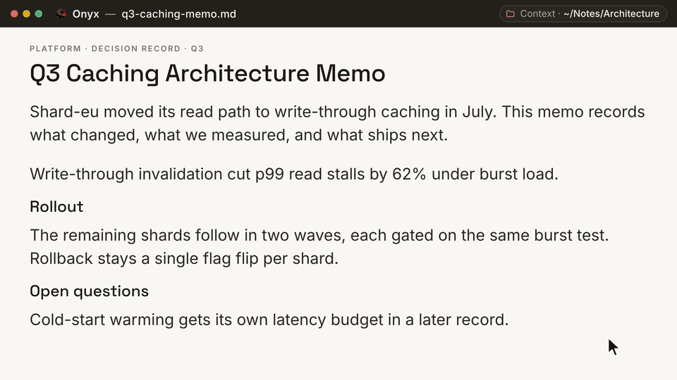

# Onyx

**A local-first second brain for Markdown notes and interactive HTML artifacts on macOS — Obsidian reinvented for the agentic era.**

Onyx unifies your Obsidian Markdown vault and your AI-generated HTML artifacts (interactive reports, explainers, dashboards, prototypes) in one native macOS workspace — with **Obsidian-style Live Preview editing ()**, **hybrid keyword + semantic search () and Related Pages powered by **, and **inline highlight-to-ask (, , )** grounded in your own files on your existing Claude or ChatGPT subscription.

Illustrative article and answer. [Watch the full 38-second overview with sound](https://cxventures.io/products/onyx).

## Why

Coding agents now produce rich interactive HTML artifacts alongside plain Markdown notes, while traditional note apps treat HTML as second-class files and force you to copy passages out into a chat window to interrogate them.

Onyx brings both worlds together on disk:

- **One library for Notes + HTML Artifacts:** browse, organize, and cross-link your Obsidian vault and local HTML artifacts side by side. Trusted local HTML keeps its interactive scripts and buttons, and Onyx adapts its chrome to match the page's palette.
- **Shared hybrid search & MCP ():**  search and the **Related** sidebar rank passages by keywords + local Ollama embeddings across Notes and Artifacts *together* — using the exact same local SQLite index that Claude Code and Codex query over MCP via .
- **Ask inside the page with verified proof:** highlight any passage in a note, HTML artifact, or PDF and right-click for **ELI5**, **Prove it**, or **Ask a question…**. Answers stream inline with a visible tool trace and citations that are verified to exist on disk before they are shown — running strictly on your Claude or ChatGPT subscription, never an API key.

## Quickstart

Download the latest `Onyx-<version>-macOS-arm64.dmg` from
[Releases](https://github.com/cxrobx/onyx/releases/latest), open it, and drag
Onyx to Applications. The app is signed and notarized. It runs on Apple Silicon
Macs with macOS 13 or newer.

On first launch Onyx opens **Settings ▸ Setup**, a checklist with a fix beside
each step:

1. **Claude or Codex, signed in.** Install the
   [Claude Code CLI](https://docs.claude.com/en/docs/claude-code) and run
   `claude` once to sign in with a paid claude.ai plan, or install the Codex
   CLI and sign in with ChatGPT. Onyx never uses an API key.
2. **Obsidian vault.** Onyx picks the vault Obsidian has open. Choose another
   one here if you like.
3. **Artifacts folder.** Onyx creates `~/Documents/Artifacts` for HTML pages.
4. **Onyx plugin in Obsidian.** Press **Install plugin**, then quit and reopen
   Obsidian. If Obsidian shows Restricted mode, turn it off in Settings ▸
   Community plugins.
5. **Vault look.** Arrives from the plugin within a few seconds, and Onyx then
   matches your vault's colours and fonts.

Setup stops opening on its own once every step passes, or after you press
**Don't open Setup on launch**. It stays in Settings either way.

**Settings ▸ Appearance ▸ Match page appearance (HTML)** is on by default. The
sidebar, tabs and answer panel follow the HTML page’s colours while keeping the
interface font. Notes, image backgrounds and pages without readable solid colours
keep the vault or Onyx appearance. Turn it off to keep that appearance everywhere.

If you use Alfred, download
[`Open-in-Onyx.alfredworkflow`](https://github.com/cxrobx/onyx/releases/latest/download/Open-in-Onyx.alfredworkflow) from the same
release and double-click it. It adds `onx` and `onxc` search and an **Open in
Onyx** action; see [docs/integrations.md](docs/integrations.md#open-from-finder-or-alfred).

To build the app yourself, or run the service from a checkout, see [docs/install.md](docs/install.md).

Then open a document from **Library**, select a passage, right-click, and choose
**ELI5**, **Prove it**, or **Ask a question…**.

## What it does

### Second brain for Notes & HTML Artifacts
- **Unified Library, Notes & Artifacts sidebar ( /  / ):** browse your Obsidian vault (wikilinks, YAML Properties, callouts, tags, drag-and-drop reorganization with automatic link rewriting) alongside your **Artifacts** folder of interactive HTML pages anywhere on disk.
- **Obsidian-style Live Preview ():** toggle any Markdown note into inline Live Preview editing with autosave, conflict detection against external edits (Obsidian or agents), interactive task checkboxes, and live outline sync.
- **First-class interactive HTML:** trusted local HTML artifacts retain their scripts and interactive controls, and **Match page appearance** adapts Onyx's sidebar, tabs, and answer panel to the page's palette automatically.
- **Hybrid semantic search () & Related Pages:** searches titles and passages across Notes and Artifacts *together* using the shared  index (BM25 + local Ollama embeddings) — surfacing related HTML artifacts from a Markdown note and vice versa.

### Inline Highlight-to-Ask & Agent Handoff
Three actions on any selection (or on a whole page when nothing is selected):

- **ELI5** — explains the passage plainly.
- **Prove it** — verifies the claim against your context folder and returns a *Supported*, *Partially supported*, *Not supported*, or *No evidence* verdict with verified-on-disk citations.
- **Ask a question…** — answers anything about the passage, with follow-ups and a searchable conversation history ().
- **Open in Claude / Codex** — hands the active page, selection, and conversation straight into a dedicated terminal session (or copies the handoff prompt with ).
- **System-wide integrations:** Obsidian plugin, Alfred workflow ( / ), and macOS Services ().

## Docs

| Doc | What's in it |
|---|---|
| [docs/features.md](docs/features.md) | The full feature list and recent version notes |
| [docs/install.md](docs/install.md) | Building the app from source, what the launcher does, running from a checkout, running headless, CLI options |
| [docs/reader.md](docs/reader.md) | Using the reader, Vault mode, Artifacts, supported documents, opening a document by URL |
| [docs/integrations.md](docs/integrations.md) | Finder, the macOS Services, the Alfred workflow and its `onx`/`onxc` search, the Obsidian plugin |
| [docs/storage.md](docs/storage.md) | Library, the database and what it saves, context roots, trusted roots |
| [docs/security.md](docs/security.md) | The security model of the local service |
| [docs/development.md](docs/development.md) | Test and build commands, release signing and notarization, project layout |
| [AGENTS.md](AGENTS.md) | Invariants and deliberate old names, for anyone changing the code |

## Contributing with an agent

Point your coding agent at [`AGENTS.md`](AGENTS.md) before it changes anything.
It is short on purpose: the invariants that must not be relaxed, the one command
that actually runs the suite, and the names that look stale but are load-bearing
contracts. Claude Code, Cursor, and Codex all read it automatically.

## License

[Business Source License 1.1](LICENSE), © 2026 CX Ventures LLC. The source is
available and you may use it personally or inside your own organisation.
Selling it, hosting it for others or bundling it into a commercial product
needs a commercial licence. Each version becomes Apache-2.0 on 2030-09-30 or
four years after its release, whichever comes first.
Versions published before 2026-09-30 were released under the MIT licence.

The project was renamed from **Ask Widget** to **Onyx**; the licence is
unchanged by that, and the built wheel carries
`License-Expression: BUSL-1.1` with `LICENSE` bundled. No third-party code is
vendored here, and every runtime dependency (FastAPI, uvicorn, markdown-it-py,
pypdf) is MIT- or BSD-licensed.
